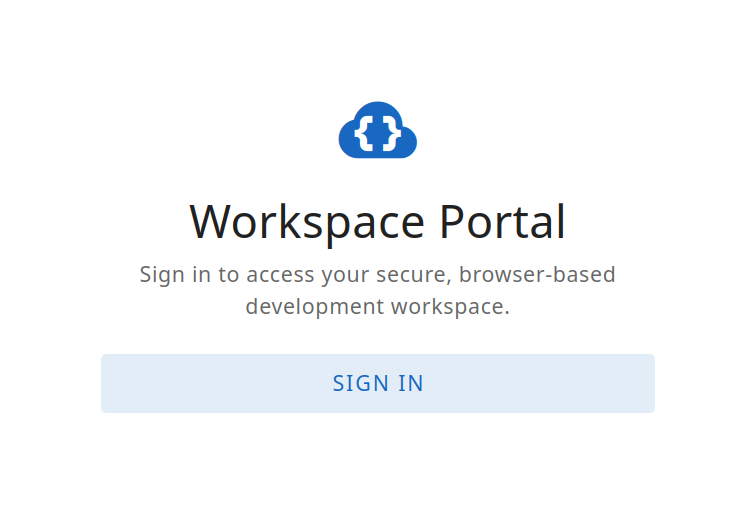
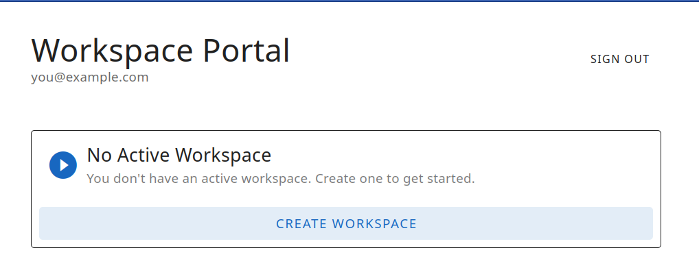
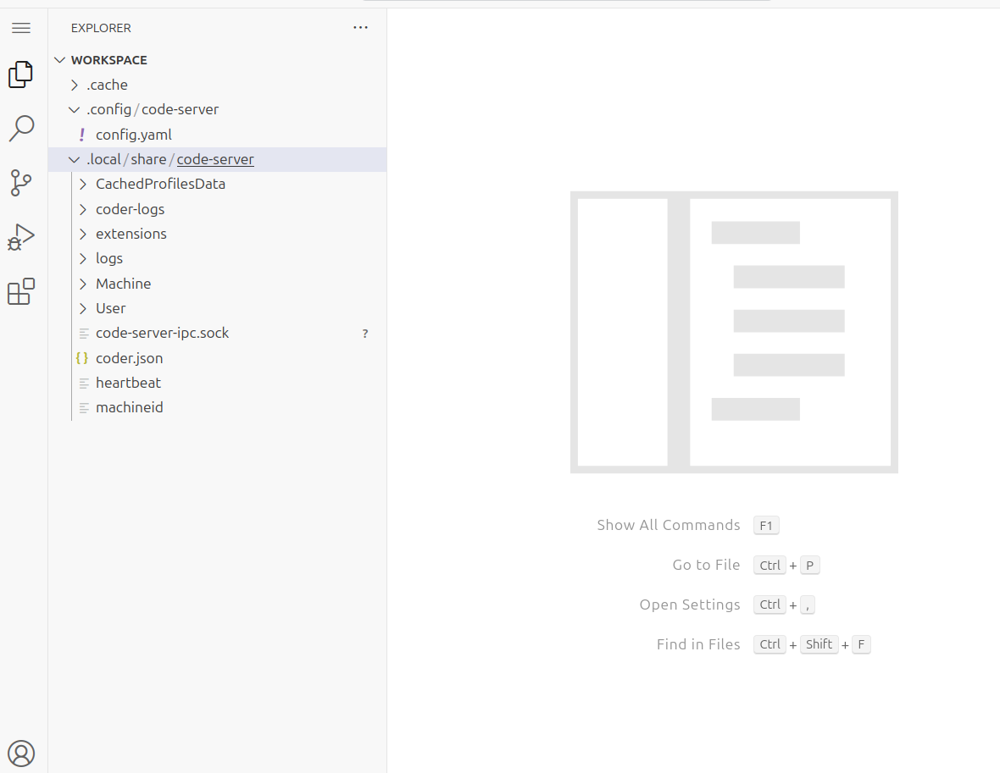

# aws-cognito-ephemeral-ecs-coder-containers

Browser-based development workspaces hosted inside AWS, accessed through Coder (VS Code in the browser). Users sign in via Cognito, the platform provisions an isolated workspace for them, and workspaces are automatically cleaned up on a schedule.

The goal is to let developers perform operational and development work inside a governed AWS environment without extending the private network to their local machines. Each user gets one active workspace at a time — a dedicated CloudFormation stack with its own load balancer, ECS Fargate task running Coder, and encrypted EFS storage. The platform enforces authentication at the load balancer edge and handles provisioning, reconnection, and expiration through a small set of services.

```bash
make deploy AUTO_APPROVE=1 USER_EMAIL=you@example.com
make user USER_EMAIL=someone@example.com
make destroy AUTO_APPROVE=1
```

| Ref                         | Ref                         | Ref                         |
| --------------------------- | --------------------------- | --------------------------- |
|  |  |  |

## Notes

- Users authenticate through Cognito and receive a JWT that back-end services validate.
- The frontend portal handles Cognito PKCE login, workspace lookup, provisioning, and reconnect.
- One user gets at most one active workspace. Creating a new one tears down the old one.
- Workspace provisioning is driven by creating a CloudFormation stack per user.
- Any production system will require some means of a warm pool, as provisioning time is notable
- Warn pool could be accomplished with dynamic names (`wsXYZXYZXYZ`) or per user environments (`XYZXYZ.jdoe`)
- Aspects of the infrastructure should be broken into smaller reusable stable components

Overall solid implementation by the factory, but the original implementation encountered a number of errors.
